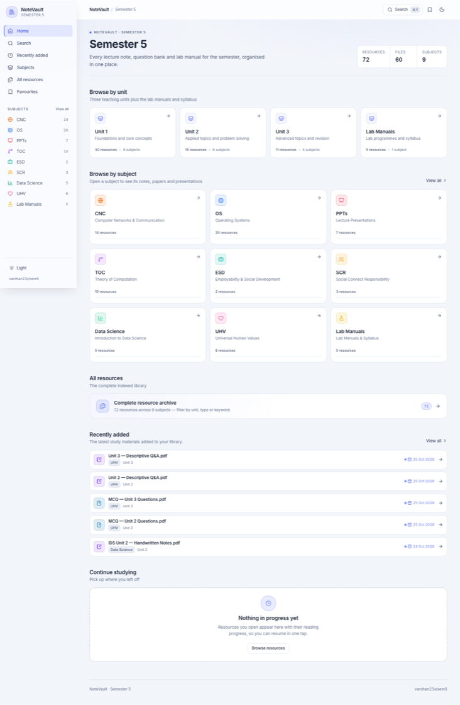
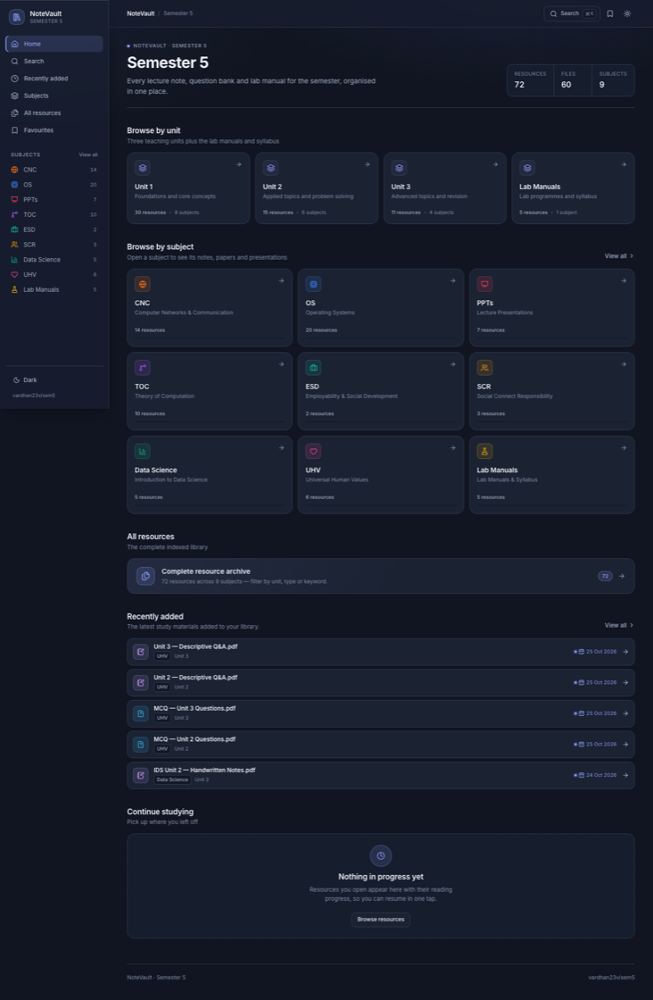
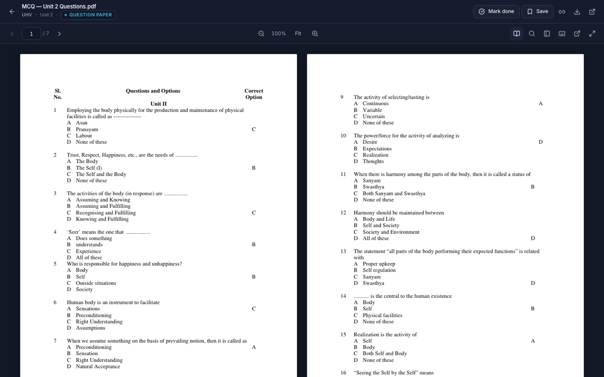

# NoteVault — Semester 5

<p align="center">
  <a href="https://vardhan23v.github.io/sem5/">
    
  </a>
  
  
  
  
</p>

Study materials for my 5th semester, organised by subject and readable right in the browser —
with a built-in PDF reader (zoom, find, thumbnails, two-page view), reading-progress resume,
search, and an installable offline shell.

**Live site:** https://vardhan23v.github.io/sem5/

| Frosted Daylight (light) | Midnight Glass (dark) |
| --- | --- |
|  |  |



---

## What's inside

**72 indexed resources** across **9 subjects** — 60 PDF, slide and HTML files plus 12
important-topic scans.

| Subject | Contents |
|---------|----------|
| CNC | Computer Networks & Communication — unit PDFs, HTML notes, MCQs, important-topic scans |
| OS | Operating Systems — unit and chapter PDFs, HTML notes, MCQs, important-topic scans |
| TOC | Theory of Computation — master notes, interactive HTML notes, MCQs, MSE papers |
| Data Science | Unit PDF and interactive HTML notes |
| PPTs | Lecture presentations for CNC, OS and Data Science |
| ESD | Employability & Social Development |
| SCR | Social Connect Responsibility |
| UHV | Universal Human Values — MCQs and descriptive Q&A |
| Lab Manuals | C++, CNC and OS lab manuals, plus the syllabus |

Resources are grouped by the real units — **Unit 1 (30) · Unit 2 (15) · Unit 3 (11) ·
Lab Manuals (5)**. There is no Unit 4 in this semester; every count on the site is derived
from the index at runtime, never hardcoded.

## Features

- **Dashboard** — unit cards, subject cards, the complete archive, *Recently added*
  (fresh files get a date highlight) and *Continue studying*, built from your history.
- **Built-in PDF reader** — page navigation, jump-to-page, zoom (buttons or `+` / `−` / `0`),
  a **two-page (book) view** toggle (`b`) with whole-spread navigation, thumbnail rail,
  nested find with match counts (`Ctrl/⌘F`), fullscreen and a shortcuts modal (`?`).
- **Reading progress** — the page you reached is saved for every PDF and offered back with a
  resume chip; deep links like `#/reader?file=…&page=12` open exactly there.
- **Favourites and mark-as-done** on every card, with per-subject completion bars.
- **Search** across names, topics, subjects and units — keyword + file type + unit + subject
  filters, AND-combined, shareable through the URL.
- **HTML notes and images** open in the same reader; PPT/PPTX files fall back to download.
- **Light, dark or follow-the-system themes.** First launch follows the OS; the choice sticks.
- **Old links keep working** — `#file=`, `#unit=`, `#subject=`, `#all` and `#search`
  fragments are translated to the new routes.
- **Installable PWA** with an offline app shell; responsive from 320px up.

## Design system — Soft Glass

Frosted *glass* is reserved for **fixed chrome** (sidebar, topbar, PDF toolbar, resume chip,
find bar, toasts); cards, rows and the PDF canvas stay opaque for legibility and scroll
performance.

- **Two palettes, one file** — `src/styles/tokens.css` holds every colour, spacing, radius,
  shadow and motion token for both themes; components never hardcode colours.
- **Glass primitives** — `.nv-glass` / `.nv-glass--strong` utilities plus `--glass-*` tokens,
  with `@supports` fallbacks to solid surfaces (`-webkit-backdrop-filter` covered).
- **Theme engine** — an inline pre-paint script in `index.html` resolves the stored
  preference (`notevault_theme`: `light | dark | system`) before first paint, so there is no
  flash on load; `useTheme` keeps the `data-theme` attribute, the dual `theme-color` metas and
  live OS-channel changes in sync. The menu (sidebar) is a `menuitemradio` group with full
  keyboard support; the topbar carries a quick toggle.
- **Accessibility** — AA-verified text/contrast tokens in both themes, non-colour-only pressed
  states (dot indicators), visible focus rings, 40px touch targets on viewports ≤ 430px, and a
  global `prefers-reduced-motion` kill-switch that collapses all entrance/transition motion.

## Architecture notes

- **Single source of truth**: `src/data/subjects.ts` — one entry per file. `src/lib/library.ts`
  builds the memoised indexes and *derives* every runtime number from it (72 resources,
  60 files, 12 scans, units 30/15/11/5, subject counts). There are no hardcoded totals.
- **Date pipeline**: `scripts/index-added.mjs` (wired via `predev` / `pretest` / `prebuild`,
  or `npm run index:added`) derives each resource's `addedAt` from Git history — the most
  recent commit that placed the file at its current path — and writes
  `src/data/added-dates.json`, which the app joins back onto every entry.
  Uncommitted files fall back to their creation time until the next commit lands.
- **Build pipeline**: `npm run build` = type-check → `vite build` → `copy-resources.mjs`,
  which copies only the files referenced by the index into `dist/` (~210 MB, all assets
  reachable offline-able paths under `/sem5/`).
- **Service worker** (`public/sw.js`, cache `notevault-v3`): network-first navigation with a
  cached-shell fallback, cache-first hashed assets, active-version cleanup — and **PDFs are
  never cached** (they are large, support range requests, and must come from the network).
- **Persistence**: plain `localStorage` adapters (`src/lib/storage.ts`), private-browsing-safe
  (every read/write is guarded), reading the pre-React app's shapes as-is:

  | Key | Holds |
  | --- | --- |
  | `notevault_favorites` | favourited resource paths |
  | `notevault_done` | mark-as-done paths |
  | `notevault_progress` | per-file `{page, total, updatedAt, percentage}` |
  | `notevault_history` | last 8 opens (feeds *Continue studying*) |
  | `notevault_theme` | `light` \| `dark` \| `system` |
  | `notevault_reader_spread` | `"1"` when two-page view is on |

## Getting started

Requires **Node.js ≥ 22.13**.

```bash
npm ci
npm run dev       # http://localhost:3000/ (server root; dev keeps resource URLs simple)
```

| Command | Purpose |
| --- | --- |
| `npm run dev` | dev server at `:3000` |
| `npm run check` | TypeScript, no emit |
| `npm test` | Vitest unit tests |
| `npm run build` | type-check → bundle → copy the 72 indexed resources into `dist/` |
| `npm run preview` | serve the production build at `http://localhost:4173/sem5/` |
| `npm run index:added` | regenerate `added-dates.json` from Git history |

Production is served from `/sem5/` (see `vite.config.ts`: the base is mode-dependent, so
development and preview stay at the server root while the Pages build keeps its long-lived
absolute asset links).

## Project structure

```
src/
  data/subjects.ts        authoritative resource metadata (one entry per file)
  data/units.ts           the four real units
  data/added-dates.json   Git-derived timestamps (generated — do not hand-edit)
  lib/library.ts          indexes, counts and lookups
  lib/filters.ts          search + AND-combined filters
  lib/storage.ts          legacy-compatible localStorage adapters
  lib/legacyLinks.ts      pre-migration hash translation
  components/             layout, cards, search, reader (PdfReader, ThumbnailRail)
  pages/                  home, search, subjects, units, all, favourites, reader
  hooks/                  app state, theme engine, PDF loading
  styles/                 design tokens + glass primitives (.nv-glass)
scripts/
  index-added.mjs         Git-history date indexer (pre-hooks)
  copy-resources.mjs      post-build dist resource copy
public/                   service worker, 404 fallback, manifest, icons
```

## Adding materials

1. Drop the file into the matching subject folder (or create one).
2. Add an entry with `name`, `path`, `units`, `kind` and `topic` to `src/data/subjects.ts`.
3. If the subject or unit is new, update `src/data/units.ts` and the subject list as well.
4. Run `npm test` — the library tests check that every indexed path exists on disk and that
   counts add up.
5. Run `npm run build`; `copy-resources.mjs` ships exactly the referenced files to `dist/`.

## Tests

Vitest covers the parts most likely to break silently:

- resource indexing, unique IDs, and derived counts (72 / 60 / 12, units 30 / 15 / 11 / 5)
- every indexed file existing on disk
- search normalisation and AND-combined filters
- storage migration from the legacy progress/history shapes, including corrupt JSON
- legacy hash translation and one-time redirects

## Deployment

Pushes to `main` trigger `.github/workflows/deploy.yml`: `npm ci` → type-check + tests →
`npm run build` → publish `dist/` to GitHub Pages (checkout with `fetch-depth: 0` so the date
indexer sees full history). `dist/` is self-contained: every referenced resource, `.nojekyll`,
`404.html`, the manifest and the service worker.

Deep links use hash routing, so they survive a refresh on Pages, and path-based fallbacks are
forwarded by `public/404.html` to the equivalent hash route. The service worker picks up a new
deployment on the next load (network-first navigation).

## Tech

React 19 · TypeScript · Vite 8 · React Router (hash history) · CSS Modules with design
tokens · Lucide icons · PDF.js. Tests with Vitest. No backend; no runtime dependencies beyond
the framework.

## License

MIT — feel free to adapt this for your own course materials.
